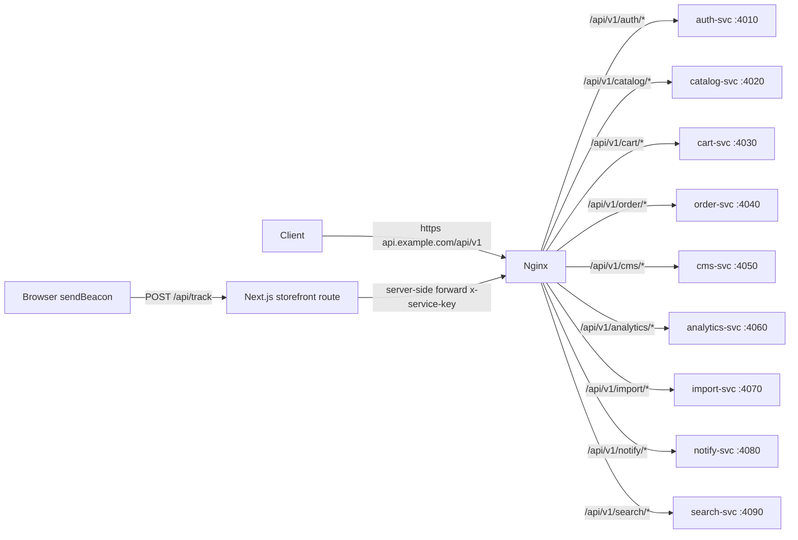
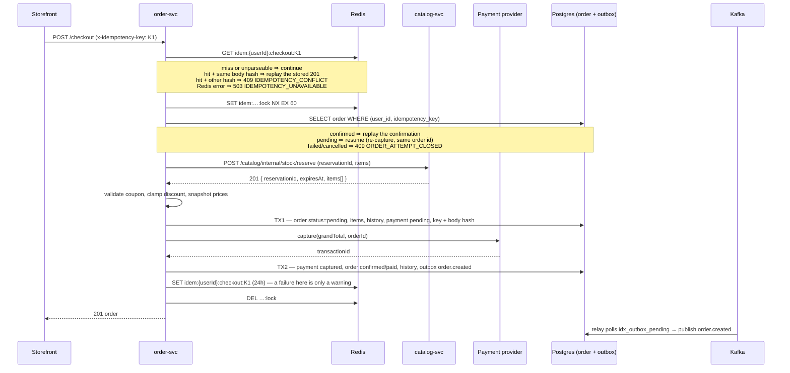
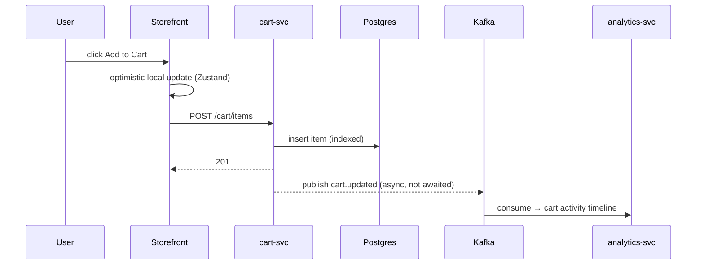
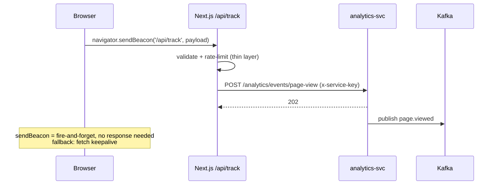
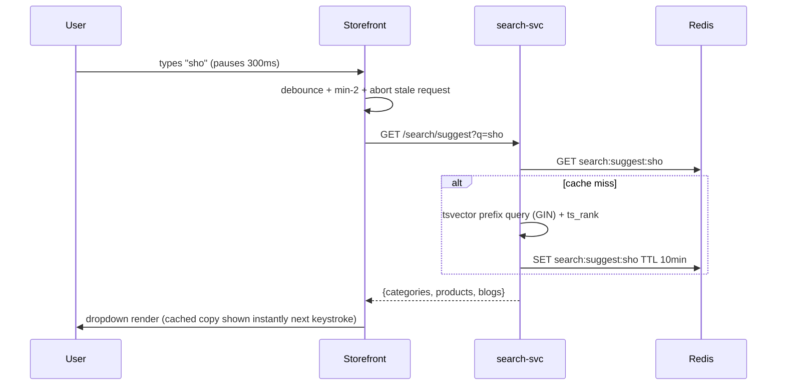

# 4. API Design

> REST API Contracts for All 9 Microservices (polyrepo — 1 repo per service, see `2.Tech-Stack.md §3`)
> Status: Draft | Last Updated: 2026-10-27
> Parent: `0.Project-Overview.md` | Siblings: `1.Architecture.md` (Kafka log + SQS tasks), `3.Database-Schema.md` | Contracts: `@ecom/contracts` (semver `8.Versioning.md`)

---

## 1. API Conventions (global rules)

### 1.1 Base Path & Versioning
- All APIs: `https://api.example.com/api/v1/{route}/*` — routed by Nginx to services (§2).
- Path versioning (`/v1/`) — simplest, cache-friendly; breaking changes bump to `/v2/`.

### 1.2 Authentication Headers
| Header | Where | Value |
|---|---|---|
| `Authorization: Bearer <accessToken>` | storefront/admin → API | Customer or admin JWT (15m) |
| `x-service-key` | service → service | Static internal key per service (v1) |
| `x-request-id` | everywhere | UUID generated at Nginx; echoed in responses + logs |
| `x-idempotency-key` | checkout, cart mutations | UUID from client — dedupe guard (§1.7) |

> The gateway verifies the token and strips forged identity headers. Services
> with role-sensitive routes re-verify the JWT and enforce the required
> role/permission; `x-roles` is never trusted. Identity-only routes may use
> the gateway's trusted `x-user-id` on the private path.

### 1.3 Pagination
| Context | Strategy | Params | Response |
|---|---|---|---|
| Storefront lists (products, orders, blogs) | **Cursor** | `?cursor=base64(createdAt_uuid)` + `?limit=24` | `{ data: [...], nextCursor: "..." }` — stable under inserts, no offset drift |
| Admin tables | **Offset** | `?page=1&perPage=25` | `{ data: [...], page, perPage, total }` |

Cursor encoding: `base64("<createdAtISO>|<id>")` — lexicographically sortable; `nextCursor: null` = no more pages.

### 1.4 Filtering & Sorting (storefront lists)
- Filters: `?category={slug}`, `?brand={slug}`, `?minPrice=10&maxPrice=100`, `?tag=summer`, `?q=keyword` (search), `?discounted=true`
- Sort: `?sort=price.asc | price.desc | newest | rating` (default `newest`)
- Compare: `?ids=uuid1,uuid2` (max 4)

### 1.5 Error Envelope
```json
{
  "error": {
    "code": "PRODUCT_NOT_FOUND",
    "message": "Product with slug 'x' does not exist",
    "details": [{ "field": "price", "message": "must be >= 0" }]
  },
  "requestId": "5f2c...",
  "timestamp": "2026-08-16T10:00:00Z"
}
```

| Status | Meaning |
|---|---|
| 400 | Validation error (`VALIDATION_FAILED`) |
| 401 | Missing/invalid token (`UNAUTHENTICATED`) |
| 403 | Role insufficient (`FORBIDDEN`) |
| 404 | Not found (`*_NOT_FOUND`) |
| 409 | Conflict — duplicate/invalid state (`DUPLICATE_SKU`, `STOCK_INSUFFICIENT`, `IDEMPOTENCY_CONFLICT`) |
| 422 | Semantic failure (`COUPON_EXPIRED`, `COUPON_USED`) |
| 429 | Rate limited (`RATE_LIMITED`) |
| 500 | Unexpected (`INTERNAL_ERROR`) |
| 503 | Dependency unavailable (`SERVICE_UNAVAILABLE`) |

Cart settings add three specific codes: `UNKNOWN_SETTING` (400), `INVALID_SETTING_VALUE` (400), and `SETTINGS_VERSION_CONFLICT` (409, with the current version in `details`).

Health/readiness responses are the one exception: probes parse status, not envelopes, so they carry only `status`/`checks` (see §1.9).

### 1.6 Rate Limits (Nginx, per IP)
| Group | Limit |
|---|---|
| `/api/v1/auth/login`, `/api/v1/auth/refresh` | 10 req/s |
| `/api/v1/order/checkout` | 5 req/s |
| `/api/v1/cart/settings` | 5 req/s (admin; writes 2/s) |
| `/api/v1/analytics/events/*` | 30 req/s |
| All reads | 30 req/s per route |

### 1.7 Idempotency
- `x-idempotency-key` **required** on `POST /order/checkout`, `POST /cart/items`, `PATCH /cart/items/:id`, `DELETE /cart/items/:id`, `DELETE /cart/items`, `DELETE /cart`, and `POST /cart/merge`. UUID v4 from the client.
- **Key scope is `(user, route, key)`, never the bare key.** The server-side key is `idem:{userId}:{route}:{key}`, so two customers who happen to generate the same UUID can never replay each other's response.
- **The domain row is the authority; Redis is a replay cache.** On checkout the key is persisted on the order itself — `orders.idempotency_key` + `orders.idempotency_body_hash`, gated by a partial unique index on `(user_id, idempotency_key)` — and the Redis map (`idem:…`, 24h TTL) only short-circuits the round trip. A cache hit with no matching DB row (a restored dump, an eviction) is treated as a miss and re-derived from the database, so the cache can never invent an order.
- Replaying a key with the **same** body returns the stored response (`201`, identical `orderId`/`orderNumber`, exactly one order). Replaying it with a **different** body → `409 IDEMPOTENCY_CONFLICT`. A key whose attempt already ended in `failed`/`cancelled` → `409 ORDER_ATTEMPT_CLOSED` (the key is burned; a new attempt needs a new key). A key currently executing → `409 IDEMPOTENCY_IN_PROGRESS`.
- **Fail closed only before the first durable write.** If Redis is unreachable *before* anything is persisted, checkout returns `503 IDEMPOTENCY_UNAVAILABLE` (nothing happened, safe to retry with the same key). A Redis failure *after* the order commits is logged and the `201` still stands — the client's retry replays from the DB instead of being told a real order failed.
- The concurrent-duplicate case is settled by the unique index, not by the lock: two requests carrying the same key race to one insert, the loser gets a unique violation and is served the winner's confirmation (its own capture and stock hold are compensated).
- `POST /cart/merge` is naturally idempotent because the guest cart is consumed; the key still gives exact response replay.
- Admin `PATCH /cart/settings` is **not** keyed — its `version` field is the concurrency guard.

### 1.8 Contract-First & OpenAPI (via `@ecom/contracts`)
- Source of truth is **`ecom-contracts` repo (`@ecom/contracts`)** — event envelopes + 10 payload schemas (`src/events/`, Kafka log), task job schemas (`src/jobs/`: `send-email`, `process-row`, `resize-image`, `reminder.dispatch`), REST DTOs, Zod `cta.schema.ts` (`ctas[]` max 3), error codes. This doc references; services pin a version (no `^`). Breaking changes follow `8.Versioning.md` (MAJOR = dual-publish window + CHANGELOG).
- Full OpenAPI 3.1 specs generated per service **from `@ecom/contracts` DTOs** (Swagger module), exposed at `GET /api/v1/{route}/docs` and exported to `zod-to-openapi`.
- Event contracts live in `1.Architecture.md` §7 (Kafka log) + `@ecom/contracts/src/events/`; task contracts in `1.Architecture.md §6.6` + `@ecom/contracts/src/jobs/` — API doc only references them.
- Replay note: **Kafka log supports replay** (e.g. re-consume `product.imported` after search bug, 3–30d retention). SQS task queues delete on consume (14d max) — task retries come from redrive/visibility-timeout, not replay.
- SQS task hygiene: **long-poll 20s + batch 10, Standard queues** (FIFO only if per-user order ever needed) — avoids empty-receive inflation ($0.40/M Standard / $0.50/M FIFO, first 1M/mo free, 64KB chunk rule).

### 1.9 Health & Readiness (every service)

Two probes, both **outside `/api/v1`** and outside the §1.5 envelope. Probes are exempt from §1.6 rate limits — a load balancer polls continuously and a per-IP cap would evict it.

| Endpoint | Checks deps | `200` | Failure | Caller |
|---|---|---|---|---|
| `GET /health` | **never** | `{"status":"ok"}` | never fails while the process runs | Docker `HEALTHCHECK`, restart policy |
| `GET /health/ready` | Postgres (v1); Redis/bus when wired | `{"status":"ready","checks":{"db":"up"}}` | `503 {"status":"not_ready","checks":{"db":"down"}}` | Compose `depends_on`, ALB target group |

Rules:
- **Liveness never touches a dependency.** A database outage must not restart the process — a restart cannot fix a downstream outage and can cascade across services.
- **Readiness answers `503`, not `500`.** "A dependency is unavailable" is a routing decision, not an application error; the LB stops sending traffic without firing a crash alarm.
- **Bodies stay minimal.** No driver messages, DSNs, or stack traces; the real error goes to the service log.
- **Bounded.** Readiness must answer within the service's probe budget (the pool connect/query timeouts), never hang.
- Ops usage (alarms, restart policy, dashboards): `10.Observability.md §3`.

---

## 2. Nginx → Service Routing Map



`proxy_pass` has **no trailing slash**: the gateway forwards the path unchanged, so each service owns its `/api/v1` prefix (§1.1) and a local `curl` hits the same URL as production.

---

## 3. Endpoint Catalog by Service

> Legend: 🛡 = requires auth (customer), 👑 = admin role, ✳ = emits Kafka event via `IEventBus` (→ §6, `1.Architecture.md §6`), 📮 = enqueues SQS task via `ITaskQueue` (→ §6.6). Envelopes from `@ecom/contracts`.

### 3.1 auth-svc — `/api/v1/auth`
| Method | Path | Auth | Request | Response | Events |
|---|---|---|---|---|---|
| POST | `/register` | — | `{email, password, firstName, lastName}` | `201 {user, accessToken, refreshToken}` | `user.registered` ✳ |
| POST | `/login` | — | `{email, password}` | `{user, accessToken, refreshToken}` | — |
| POST | `/logout` | 🛡 | — | `204` | — |
| POST | `/refresh` | — | `{refreshToken}` | `{accessToken, refreshToken}` | — |
| GET | `/me` | 🛡 | — | `{user}` | — |
| PATCH | `/me` | 🛡 | `{firstName?, lastName?, phone?, avatarUrl?}` | `{user}` | — |
| PATCH | `/me/password` | 🛡 | `{currentPassword, newPassword}` | `204` | — |
| GET | `/me/addresses` | 🛡 | — | `[{address}]` | — |
| POST | `/me/addresses` | 🛡 | address body | `201 {address}` | — |
| PATCH | `/me/addresses/:id` | 🛡 | partial address | `{address}` | — |
| DELETE | `/me/addresses/:id` | 🛡 | — | `204` | — |
| GET | `/users` | 👑 | `?page=&status=` | `{data, page, perPage, total}` | — |
| PATCH | `/users/:id/status` | 👑 | `{status}` | `{user}` | — |
| GET | `/roles` | 👑 | — | `[{role, permissions[]}]` | — |
| POST | `/roles` | 👑 | `{name, slug, permissionSlugs[]}` | `201 {role}` | — |
| PATCH | `/users/:id/roles` | 👑 | `{roleSlugs[]}` | `{userRoles}` | — |

### 3.2 catalog-svc — `/api/v1/catalog`
| Method | Path | Auth | Request | Response | Events |
|---|---|---|---|---|---|
| GET | `/products` | — | cursor + filters + sort | `{data[], nextCursor}` | — |
| GET | `/products/:slug` | — | — | product detail (PDP) | — |
| GET | `/products/:id` | — | — | product detail by id | — |
| GET | `/search` **(deprecated — use search-svc §3.9)** | — | `?q=&cursor=` | `{data[], nextCursor}` | — |
| GET | `/compare` | — | `?ids=u1,u2,u3` (max 4) | `{attributes[], products[]}` | — |
| GET | `/categories` | — | — | `{tree[]}` (nested) | — |
| GET | `/brands` | — | — | `{data[]}` | — |
| POST | `/products` | 👑 | product create body | `201 {product}` | — |
| PATCH | `/products/:id` | 👑 | partial product | `{product}` | — |
| DELETE | `/products/:id` | 👑 | — | `204` (soft delete) | — |
| POST | `/products/:id/variants` | 👑 | `{sku, price?, stock?, imageUrl?, options:[{optionId, optionValueId}]}` | `201 {variant}` | — |
| PATCH | `/variants/:id` | 👑 | partial variant | `{variant}` | — |
| DELETE | `/variants/:id` | 👑 | — | `204` | — |
| POST | `/products/:id/options` | 👑 | `{name, displayType?, showOnCard?, cardPlacement?, values:[{value, swatchHex?, swatchImageUrl?}]}` | `201 {option, values[]}` | `product.updated` |
| PATCH | `/options/:id` | 👑 | `{name?, displayType?, showOnCard?, cardPlacement?, values?}` | `{option}` | `product.updated` |
| POST | `/products/:id/badges` | 👑 | `{badgeId, priorityOverride?}` | `201 {productBadge}` | `product.updated` |
| DELETE | `/products/:id/badges/:badgeId` | 👑 | — | `204` | `product.updated` |
| GET | `/badges` | — | `?isActive=` | `{data: BadgeDto[]}` | — |
| POST | `/badges` | 👑 | `{key, label, bg, textColor, borderColor?, borderStyle?, priority?, isActive?, startsAt?, endsAt?}` | `201 {badge}` | — |
| PATCH | `/badges/:id` | 👑 | partial badge | `{badge}` | — |
| DELETE | `/badges/:id` | 👑 | — | `204` | — |
| POST | `/products/:id/images` | 👑 | `{url, alt?, variantId?}` | `201 {image}` | — |
| PATCH | `/images/:id` | 👑 | `{alt?, sortOrder?, isPrimary?}` | `{image}` | — |
| DELETE | `/images/:id` | 👑 | — | `204` | — |
| POST | `/products/:id/stock` | 👑 | `{delta: int, reason?: 'admin_adjustment'}` | `{stock, movement}` | — |
| GET | `/products/:id/stock-movements` | 👑 | `?cursor=` | `{data[], nextCursor}` | — |
| POST | `/products/:id/discounts` | 👑 | `{discountType, value, startsAt, endsAt}` | `201 {discount}` | — |
| PATCH | `/discounts/:id` | 👑 | partial discount | `{discount}` | — |
| DELETE | `/discounts/:id` | 👑 | — | `204` | — |
| GET | `/attributes` | — | — | compare-attribute defs | — |
| GET | `/reviews` | — | `?productId=&cursor=` | `{data[], nextCursor}` | — |
| POST | `/reviews` | 🛡 | `{productId, rating, title?, body?}` | `201 {review}` [optional] | — |
| PATCH | `/reviews/:id/approve` | 👑 | — | `{review}` [optional] | — |

### 3.3 cart-svc — `/api/v1/cart`
> Cart identity: verified `Authorization: Bearer` JWT (or a trusted gateway `x-user-id` on the private network for identity-only routes), else `x-session-id` for guests. Wishlist requires a verified JWT plus the `customer` role, checked in cart-svc; there is no server-side guest wishlist. Admin settings require a verified JWT plus the `admin` role. Role-sensitive routes re-verify the JWT in the owning service; never trust client-supplied `x-user-id`/`x-roles`. Merge applies `cart.settings.guestMergeStrategy` (`merge` default, `guest_wins`, `user_wins`); the settings document is never public.
| Method | Path | Auth | Request | Response | Events |
|---|---|---|---|---|---|
| GET | `/cart` | 🛡 or session | — | `{cart, items[], totals}` | — |
| POST | `/cart/items` | 🛡 or session | `{productId, variantId?, qty}` | `201 {item, cartTotals}` | `cart.updated` ✳ |
| PATCH | `/cart/items/:id` | 🛡 or session | `{qty}` | `{item, cartTotals}` | `cart.updated` ✳ |
| DELETE | `/cart/items/:id` | 🛡 or session | — | `204` | `cart.updated` ✳ |
| DELETE | `/cart/items` | 🛡 or session | `{ids[]}` (batch remove) | `204` | `cart.updated` ✳ |
| DELETE | `/cart` | 🛡 or session | — | `204` (clear) | `cart.updated` ✳ |
| POST | `/cart/merge` | 🛡 | `x-session-id` + `x-idempotency-key` | `{cart}` | `cart.updated` ✳ |
| GET | `/cart/settings` | 👑 | — | `{scope, version, values, overrides, definitions[]}` | — |
| PATCH | `/cart/settings` | 👑 | `{version, values?, reset?}` | `{scope, version, values, overrides}` | — |
| GET | `/cart/settings/audit` | 👑 | `?cursor=&limit=` [optional] | `{data[], nextCursor}` | — |
| GET | `/wishlist` | 🛡 | — | `{items[]}` | — |
| POST | `/wishlist/items` | 🛡 | `{productId}` | `201 {item}` | — |
| DELETE | `/wishlist/items/:id` | 🛡 | — | `204` | — |

> Wishlist rows require a verified JWT + `customer` role, checked in cart-svc. No guest wishlist: the storefront prompts guests to sign in, carries the pending product id through the auth redirect, and posts it after login. See §4.13.

### 3.4 order-svc — `/api/v1/order`
| Method | Path | Auth | Request | Response | Events |
|---|---|---|---|---|---|
| POST | `/checkout` | 🛡 | checkout body (§4.6) + `x-idempotency-key` | `201 {order}` | `order.created` ✳ |
| GET | `/orders/:id` | 🛡 (owner) / 👑 | — | `{order, items[], payments[]}` | — |
| GET | `/me/orders` | 🛡 | `?cursor=` | `{data[], nextCursor}` | — |
| GET | `/orders` | 👑 | `?page=&status=&from=&to=&q=` | `{data, page, perPage, total}` | — |
| GET | `/orders/:id/status-history` | 👑 | — | `[{from, to, note, actor, createdAt}]` | — |
| PATCH | `/orders/:id/status` | 👑 | `{status, note?}` | `{order}` | `order.status.updated` ✳ |
| POST | `/orders/:id/refund` | 👑 | `{amount?, reason?}` | `{order, refund}` | `order.status.updated` ✳ |
| POST | `/discount-codes/validate` | 🛡 | `{code, cartTotal}` | `{valid, discount?}` | — |
| GET | `/discount-codes` | 👑 | `?page=` | `{data, page, perPage, total}` | — |
| POST | `/discount-codes` | 👑 | `{code, discountType, value, minOrderAmount?, maxUses?, startsAt?, endsAt?}` | `201 {code}` | — |
| PATCH | `/discount-codes/:id` | 👑 | partial | `{code}` | — |
| DELETE | `/discount-codes/:id` | 👑 | — | `204` | — |

### 3.5 cms-svc — `/api/v1/cms`
> Payload validation is strictly enforced via `@ecom/contracts` Zod schemas. Public reads filter active/published documents in Mongo and return cache-busting global `version` from `cms_meta`. Admin mutations require `admin` role, bump the global revision, invalidate Redis cache keys, and emit domain events.

| Method | Path | Auth | Request | Response | Events / Jobs |
|---|---|---|---|---|---|
| GET | `/sections?pageKey=homepage` | — | — | `{sections[], version}` (active only) | — |
| GET | `/admin/sections?pageKey=homepage` | 👑 | — | `{sections[], version}` (all sections) | — |
| POST | `/admin/sections` | 👑 | `{key, type, pageKey, title?, content, settings?, isActive?}` | `201 {section}` | `cms.updated` ✳ |
| PATCH | `/admin/sections/:key` | 👑 | `{title?, content?, settings?, isActive?}` (`key/pageKey/type` immutable) | `{section}` | `cms.updated` ✳ |
| DELETE | `/admin/sections/:key` | 👑 | — | `204` | `cms.updated` ✳ |
| PATCH | `/admin/sections/reorder` | 👑 | `{pageKey, orderedKeys[]}` (pageKey required) | `204` | `cms.updated` ✳ |
| GET | `/settings/global` | — | — | `{theme, version}` | — |
| GET | `/admin/settings/global` | 👑 | — | `{theme, version}` | — |
| PUT | `/admin/settings/global` | 👑 | `{theme}` (ThemeSettings schema) | `{theme, version}` | `cms.updated` ✳ |
| GET | `/navigation` | — | — | `{navbar, version}` | — |
| GET | `/admin/navigation` | 👑 | — | `{navbar, version}` | — |
| PUT | `/admin/navigation` | 👑 | `{navbar}` (NavSettings schema) | `{navbar, version}` | `cms.updated` ✳ |
| GET | `/settings/page/:pageKey` | — | — | `{settings, version}` | — |
| GET | `/admin/settings/page/:pageKey` | 👑 | — | `{settings, version}` | — |
| PUT | `/admin/settings/page/:pageKey` | 👑 | `{settings}` (PageSettings schema) | `{settings, version}` | `cms.updated` ✳ |
| GET | `/pages` | — | — | `{data: Page[]}` (active only) | — |
| GET | `/pages/:slug` | — | — | `{page}` (active only) | — |
| POST | `/admin/pages` | 👑 | `{slug, title, blocks[], seo?, isActive?}` | `201 {page}` | `cms.updated` ✳ |
| PATCH | `/admin/pages/:slug` | 👑 | `{title?, blocks?, seo?, isActive?}` | `{page}` | `cms.updated` ✳ |
| DELETE | `/admin/pages/:slug` | 👑 | — | `204` | `cms.updated` ✳ |
| GET | `/blogs` | — | `?category=&cursor=&limit=` | `{data: Blog[], nextCursor}` (published only) | — |
| GET | `/blogs/:slug` | — | — | `{blog}` (published only) | — |
| GET | `/blog-categories` | — | — | `[{category}]` | — |
| POST | `/admin/blogs` | 👑 | `{title, slug, content[], categoryId, status, author?, seo?}` | `201 {blog}` | `blog.updated` ✳ (if published) |
| PATCH | `/admin/blogs/:id` | 👑 | `{title?, content?, categoryId?, status?, author?, seo?}` | `{blog}` | `blog.updated` ✳ |
| DELETE | `/admin/blogs/:id` | 👑 | — | `204` | — |
| POST | `/admin/blog-categories` | 👑 | `{name, slug, description?}` | `201 {category}` | — |
| POST | `/admin/media` | 👑 | multipart (`file`, `alt?`, `usage`, `visibility?` = `public`\|`private`, default `public`) (PNG/JPEG/WebP/AVIF, max 10MB) | `201 {media}` | `media.resize-image` ⚙ |
| GET | `/admin/media` | 👑 | `?usage=&visibility=&page=&perPage=` | `{data: Media[], page, perPage, total}` | — |
| DELETE | `/admin/media/:id` | 👑 | — (guarded: rejects 409 if referenced in sections/pages/blogs) | `204` | — |
| GET | `/media/file/*` | — | storage key is the rest of the path | bytes (`Content-Type` = stored MIME, `nosniff`, `Cache-Control: public, max-age=60, must-revalidate`) | — |
| GET | `/admin/media/:id/file` | 👑 | `:id` is a Mongo `ObjectId`, never a key | bytes (`Cache-Control: private, no-store`) | — |

The open file route serves `public` rows only. A `private` row and a missing
row both answer `404 MEDIA_NOT_FOUND / File not found`, with no key or path in
the body, so the route cannot be used to discover private assets; `401`/`403`
belong to the admin route. A key that fails containment (`..`, an encoded
separator, an absolute path, a null byte, an unknown extension) is `404` as
well: the route never says whether the key was rejected or simply absent.
There is no unauthenticated path to a file that has no `cms_media` row.


### 3.6 analytics-svc — `/api/v1/analytics`
> Public-facing events arrive via the Next.js `/api/track` route (sendBeacon → server-side forward). Direct hits from browsers are also accepted (CORS-open for the beacon path).
| Method | Path | Auth | Request | Response | Events |
|---|---|---|---|---|---|
| POST | `/events/page-view` | x-service-key | `{sessionId, userId?, page, referrer?, device?, eventKind}` | `202` | `page.viewed` ✳ |
| GET | `/admin/dashboard` | 👑 | `?from=&to=` | `{daily[], totals}` | — |
| GET | `/admin/funnel` | 👑 | `?from=&to=` | `{pageViews, cartAdds, checkouts, conversions}` | — |
| GET | `/admin/exits` | 👑 | `?from=&to=` | `{byPage[], byReferrer[]}` | — |
| GET | `/admin/abandoned-carts` | 👑 | `?page=&status=` | `{data, page, perPage, total}` | — |

### 3.7 import-svc — `/api/v1/import`
| Method | Path | Auth | Request | Response | Events |
|---|---|---|---|---|---|
| POST | `/import` | 👑 | multipart CSV/JSON | `202 {jobId}` | per-product `product.imported` ✳ |
| GET | `/jobs` | 👑 | `?page=&status=` | `{data, page, perPage, total}` | — |
| GET | `/jobs/:id` | 👑 | — | `{job, report}` | — |
| POST | `/import/:source/run` | 👑 | `{credentials?, filters?}` | `202 {jobId}` (Shopify/BigCommerce/Odoo — phase 2) | `product.imported` ✳ |

### 3.8 notify-svc — `/api/v1/notify`
> Almost entirely event-driven (consumes `order.created`, `cart.abandoned`, etc.).
| Method | Path | Auth | Request | Response | Events |
|---|---|---|---|---|---|
| GET | `/admin/emails` | 👑 | `?page=&status=` | `{data, page, perPage, total}` | — |
| POST | `/admin/test-email` | 👑 | `{to, template}` | `202` | — |
| GET | `/admin/templates` | 👑 | — | `[{template}]` [optional] | — |
| PUT | `/admin/templates/:key` | 👑 | `{subject, body}` | `{template}` [optional] | — |

### 3.9 search-svc — `/api/v1/search`
> Typeahead + ranked search over the unified index (products + categories + blogs). Index synced via Kafka events (`product.imported`, `product.updated`, `category.updated`, `blog.updated`) — reads only on public paths. Internal batch endpoint for seeding, DR replay, and hermetic tests.
| Method | Path | Auth | Request | Response | Events |
|---|---|---|---|---|---|
| GET | `/suggest` | — | `?q=&limit=5` | `{query, categories[], products[], blogs[]}` | — |
| GET | `/search` | — | `?q=&type=&category=&minPrice=&maxPrice=&sort=&cursor=&limit=24` | `{query, data[], nextCursor, totalHits}` | — |
| POST | `/internal/documents` | x-service-key | `{documents: SearchDocument[]}` (max 500, max 1MB) | `{accepted, skipped, rejected}` | — |
| GET | `/internal/stats` | x-service-key | — | `{documents, active, byType, lastSyncedAt}` | — |

---

## 4. Full Contracts — Critical Endpoints

### 4.1 `POST /auth/register`
**Request**
```json
{ "email": "user@example.com", "password": "Str0ng!pass", "firstName": "Jane", "lastName": "Doe" }
```
**Response `201`**
```json
{
  "user": { "id": "0190...", "email": "user@example.com", "firstName": "Jane", "lastName": "Doe", "role": "customer" },
  "accessToken": "eyJ...", "refreshToken": "rt_..."
}
```
**Emits:** `user.registered` (welcome email, cohort analytics). **Errors:** `400` invalid email/weak password; `409` email exists.

### 4.2 `POST /auth/login`
**Request** `{ "email": "...", "password": "..." }` · **Response** same shape as 4.1 · **Errors:** `401` bad credentials.

### 4.3 `GET /catalog/products?category=shoes&minPrice=20&maxPrice=100&sort=price.asc&cursor=...&limit=24`
**Response `200`**
```json
{
  "data": [
    { "id": "0190...", "slug": "running-shoe-x", "name": "Running Shoe X", "price": 79.99, "compareAtPrice": null,
      "image": { "url": "https://cdn.../1.jpg", "alt": "Running Shoe X" }, "rating": 4.5 }
  ],
  "nextCursor": "MjAyNi0wOC0xNlQxMDowMDowMFp8MDE5M..."
}
```

### 4.4 `GET /catalog/products/:slug` (PDP)
**Response `200`**
```json
{
  "id": "0190...", "slug": "running-shoe-x", "name": "Running Shoe X", "description": "...",
  "price": 79.99, "compareAtPrice": 99.99, "effectivePrice": 71.99,
  "discount": { "discountType": "percent", "value": 10, "endsAt": "2026-08-20T00:00:00Z" },
  "images": [{ "url": "...", "alt": "...", "sortOrder": 0, "isPrimary": true }],
  "options": [
    { "id": "o1", "name": "Size", "values": [{ "id": "v1", "value": "S" }, { "id": "v2", "value": "M" }] },
    { "id": "o2", "name": "Color", "values": [{ "id": "v4", "value": "Red" }, { "id": "v5", "value": "Blue" }] }
  ],
  "variants": [{ "id": "var1", "sku": "RSX-S-RED", "price": 79.99, "stock": 12, "imageUrl": null, "options": { "Size": "S", "Color": "Red" } }],
  "attributes": [{ "slug": "material", "name": "Material", "value": "Mesh" }],
  "photoSettings": { "format": "horizontal", "ratio": "4:3", "layout": "carousel", "blendMode": "multiply" },
  "stock": { "total": 34, "status": "in_stock" }
}
```
`effectivePrice` = lowest active discount applied (computed in catalog-svc). Variant `options` resolved from junction joins — this is the PDP's only "many" payload.

### 4.5 `POST /catalog/products` (admin create)
**Request**
```json
{
  "sku": "RSX-100", "name": "Running Shoe X", "slug": "running-shoe-x",
  "categoryId": "cat-1", "brandId": "br-2", "price": 79.99, "compareAtPrice": 99.99, "stock": 50,
  "description": "...", "tags": ["shoes", "running"],
  "photoSettings": { "format": "vertical", "ratio": "1:1", "layout": "grid", "gutter": 8, "blendMode": "normal" }
}
```
**Response `201`** — product object as 4.4 (without computed fields). **Errors:** `409 DUPLICATE_SKU`, `400` validation.

### 4.6 `POST /order/checkout` (idempotent)
Header: `x-idempotency-key: 5f2c...`
**Request**
```json
{
  "items": [{ "productId": "0190...", "variantId": "var1", "qty": 2 }],
  "shippingAddress": { "line1": "...", "city": "...", "postalCode": "...", "country": "US" },
  "billingAddress": { "line1": "...", "city": "...", "postalCode": "...", "country": "US" },
  "discountCode": "SAVE10",
  "payment": { "provider": "mock" }
}
```
**Response `201`**
```json
{
  "orderId": "0190...", "orderNumber": "#2026-000123", "status": "confirmed",
  "totals": { "subtotal": 159.98, "shipping": 5.0, "tax": 9.9, "discount": 15.99, "grandTotal": 158.89 },
  "items": [{ "productName": "Running Shoe X", "sku": "RSX-100", "unitPrice": 79.99, "qty": 2, "lineTotal": 159.98 }]
}
```
**Emits:** `order.created` via **transactional outbox** (same TX that flips the pending row to `confirmed`). **Replay:** same key → the stored confirmation, byte for byte.

**The order is persisted before the money moves.** `201` means the order exists, is `confirmed` and is paid — never a promise: the row is inserted as `pending` first, the capture runs against that `orderId`, and only then is it confirmed (§5.1). A `pending` order therefore only survives when the attempt was interrupted, and retrying with the same key resumes it.

| Status | `code` | When | Client action |
|---|---|---|---|
| `400` | `VALIDATION_FAILED` | body fails the DTO | fix the body |
| `402` | `PAYMENT_FAILED` | the provider declined the card | new key, new attempt (the key is burned) |
| `409` | `STOCK_INSUFFICIENT` / `RESERVATION_CLOSED` / `RESERVATION_CONFLICT` | the hold could not be taken | refresh the cart |
| `409` | `IDEMPOTENCY_CONFLICT` | same key, different body | new key |
| `409` | `IDEMPOTENCY_IN_PROGRESS` | the same key is executing right now | retry shortly |
| `409` | `ORDER_ATTEMPT_CLOSED` | the key's attempt already ended `failed`/`cancelled` | new key |
| `422` | `COUPON_EXPIRED` / `COUPON_USED` | the coupon is not redeemable | drop the coupon |
| `502` | `CATALOG_CONTRACT_ERROR` | catalog rejected our body (deploy skew) | page the platform team |
| `503` | `CATALOG_UNAVAILABLE` / `IDEMPOTENCY_UNAVAILABLE` | dependency down **before** anything was written | retry with the same key |
| `503` | `PAYMENT_UNAVAILABLE` | the provider could not be reached; the order stays `pending` | retry with the same key (resumes) |
| `503` | `CHECKOUT_UNAVAILABLE` / `PAYMENT_PERSIST_FAILED` | the write failed after stock was held (a capture is refunded first) | retry with the same key |

### 4.7 `POST /cart/items`
Headers: `x-idempotency-key` **required**, `x-session-id` for guests.
**Request** `{ "productId": "0190...", "variantId": "var1", "qty": 1 }` · **Response `201`** `{ "item": { "id": "ci-1", "productId": "...", "variantId": "...", "qty": 1, "unitPrice": 79.99 }, "cartTotals": { "subtotal": 79.99, "itemCount": 1, "lineCount": 1 } }` · **Emits:** `cart.updated` fire-and-forget. Replaying the same key returns the stored response; a different body under the same key → `409 IDEMPOTENCY_CONFLICT`.

### 4.8 `DELETE /cart/items` (batch remove)
**Request** `{ "ids": ["ci-1", "ci-2", "ci-3"] }` · **Response `204`** · **Emits:** one `cart.updated`. Performance: 1 round trip instead of N (P99 < 100ms target @ 200 items).

### 4.9 `POST /import/import` (multipart upload)
**Request** `multipart/form-data`: `file` (CSV/JSON), fields: `source=csv`, `options={ "stockMode": "replace" }` · **Response `202`** `{ "jobId": "0190...", "status": "pending" }` · **Flow:** rows enqueued to `import.process-row` tasks 📮 → worker validates → per-product `product.imported` Kafka events → report on `GET /jobs/:id` `{ totalRows, successCount, failedCount, errors[] }`.

### 4.10 `GET /cms/sections?pageKey=homepage`
**Response `200`**
```json
{
  "sections": [
    {
      "key": "home-hero",
      "type": "hero",
      "content": {
        "slides": [
          {
            "id": "slide_01",
            "headline": "Summer Sale",
            "image": "s3://.../hero-01.jpg",
            "ctas": [
              { "id": "cta_01", "text": "Shop now", "link": "/products", "bg": "#111111", "textColor": "#ffffff", "borderRadius": 6 }
            ]
          }
        ]
      },
      "settings": { "ratio": "16:9", "blendMode": "multiply" },
      "sortOrder": 0,
      "isActive": true
    },
    {
      "key": "home-banner-01",
      "type": "banner",
      "content": { "title": "Free shipping over $50", "image": "s3://.../banner.jpg", "ctas": [{ "id": "cta_b1", "text": "Learn more", "link": "/about" }] },
      "settings": {},
      "sortOrder": 1,
      "isActive": true
    }
  ],
  "version": 7
}
```
`version` = global settings cache-buster; storefront caches by version. Each `ctas` array is `0..3` items (`z.array(ctaSchema).max(3)`); `ctas: []` renders no CTA row. Legacy docs with flat `ctaText/ctaLink` are auto-migrated to `ctas[0]` in the resolver.

### 4.11 `GET /search/suggest?q=sho&limit=5`
**Response `200`** — one combined payload, deliberately lightweight (no ranking, no filters, `5+5+5` max):
```json
{
  "query": "sho",
  "categories": [{ "id": "c1", "name": "Shoes", "slug": "shoes", "image": "https://cdn.../c1.jpg" }],
  "products": [
    { "id": "0190...", "slug": "running-shoe-x", "name": "Running Shoe X", "image": "https://cdn.../1.jpg", "price": 79.99, "effectivePrice": 71.99 }
  ],
  "blogs": [{ "id": "b1", "slug": "best-running-shoes-2026", "title": "Best Running Shoes 2026", "cover": "https://cdn.../b1.jpg" }]
}
```
Server-side: `to_tsquery('english', 'sho:*')` prefix match (GIN index), `status='active'`, ordered by `ts_rank` + popularity; Redis-cached `search:suggest:sho` TTL 10min. Client-side contract: debounce 300ms, min 2 chars, AbortController, in-memory cache + stale-while-revalidate (spec in `5.Features.md`).

### 4.11b `GET /search?q=running+shoes&limit=24`
**Response `200`** — ranked full search results with facets and query-bound cursor pagination:
```json
{
  "query": "running shoes",
  "data": [
    {
      "id": "0190...",
      "type": "product",
      "title": "Running Shoe X",
      "slug": "running-shoe-x",
      "image": "https://cdn.../1.jpg",
      "price": 79.99,
      "effectivePrice": 71.99,
      "popularity": 12,
      "updatedAt": "2026-10-28T09:00:00.000Z"
    }
  ],
  "nextCursor": "eyJ2IjoxLCJxIjoiM2YxMG...",
  "totalHits": 42
}
```
Query parameters: `q` (required, 2-100 chars), `type` (product|category|blog), `category` (slug), `minPrice`/`maxPrice` (numeric, product only), `sort` (`relevance`|`price.asc`|`price.desc`|`newest`|`popular`), `cursor` (opaque base64url query-scoped), `limit` (1-50, default 24).
Headers: `Cache-Control: public, max-age=30, stale-while-revalidate=30`.

### 4.11c `POST /search/internal/documents` (Internal)
Protected by `x-service-key`. Used for seeding, disaster recovery backfills, and hermetic tests. Max 500 documents per batch, max 1MB payload.
**Request `POST /api/v1/search/internal/documents`**
```json
{
  "documents": [
    {
      "id": "0190...",
      "documentType": "product",
      "title": "Running Shoe X",
      "slug": "running-shoe-x",
      "content": "Running Shoe X Lightweight road shoe",
      "imageUrl": "https://cdn.../1.jpg",
      "price": "79.99",
      "effectivePrice": "71.99",
      "categoryId": "c1",
      "popularity": 12,
      "status": "active",
      "sourceUpdatedAt": "2026-10-28T09:00:00.000Z"
    }
  ]
}
```
**Response `200`**
```json
{
  "accepted": 1,
  "skipped": 0,
  "rejected": 0
}
```

### 4.12 `GET/PATCH /cart/settings` (admin only)

Verified Bearer JWT + `admin` role. No public settings route. `Cache-Control: no-store`; `Vary: Authorization`. The policy value itself is not a secret, but the admin document, definitions, actor ids, and audit are admin-only.

**GET `/api/v1/cart/settings`**
```json
{
  "scope": "global",
  "version": 4,
  "values": { "guestMergeStrategy": "merge" },
  "overrides": {},
  "definitions": [
    {
      "key": "guestMergeStrategy",
      "group": "guestCart",
      "label": "Guest-to-account cart behavior",
      "type": "select",
      "options": ["merge", "guest_wins", "user_wins"],
      "defaultValue": "merge",
      "visibility": "admin"
    }
  ],
  "updatedAt": "2026-10-26T10:00:00Z",
  "updatedBy": "uuid"
}
```
`values` is the resolved document (defaults + overrides); `overrides` is what is actually stored. `definitions` lets a generic admin screen render future settings without a new endpoint.

**PATCH `/api/v1/cart/settings`**
```json
{ "version": 4, "values": { "guestMergeStrategy": "guest_wins" } }
```
Reset to the registry default with `{ "version": 4, "reset": ["guestMergeStrategy"] }` — reset deletes the override; it never writes `null`.

Rules:
- `version` is required. Stale version → `409 SETTINGS_VERSION_CONFLICT`; `details` carries the current version.
- Unknown key → `400 UNKNOWN_SETTING`; invalid value → `400 INVALID_SETTING_VALUE`; no partial update.
- `values` is shallow-merged; `reset` keys are deleted in the same transaction.
- The update and the `cart.settings_audit` insert commit together. Audit is append-only.
- A save is runtime data: no build, no redeploy. The next merge reads the new policy.
- Secrets are never stored in this document; `visibility: "secret"` settings come from a secret manager and return only configured/not-configured.
- `GET /cart/settings/audit` is an optional admin-only read endpoint; it is not part of the public cart API.

**Errors:** `401 UNAUTHENTICATED`, `403 FORBIDDEN`, `400 UNKNOWN_SETTING`, `400 INVALID_SETTING_VALUE`, `409 SETTINGS_VERSION_CONFLICT`.

### 4.13 `GET/POST/DELETE /wishlist` (customer)

Wishlist is a product-level "save for later" list. It is not a cart and
never emits `cart.updated`. Auth is a verified Bearer JWT + `customer` role,
checked in cart-svc; there is no server-side guest wishlist. The gateway is
the first line, but cart-svc re-verifies the JWT and scopes every query by
`user_id = JWT.sub`.

**GET `/api/v1/wishlist`**
```json
{
  "items": [
    {
      "id": "uuid",
      "productId": "uuid",
      "addedAt": "2026-10-27T10:00:00Z"
    }
  ]
}
```
An empty list is valid when the user has no wishlist row; `GET` does not
create one. `POST` creates the row lazily. No product snapshot is stored; the
storefront hydrates name/price/image from catalog by `productId`.

**POST `/api/v1/wishlist/items`**
```json
{ "productId": "uuid" }
```
`201 {item}`. The unique `(wishlist_id, product_id)` makes the add
idempotent: a duplicate returns the existing item with the same `id` and
`addedAt`. No `x-idempotency-key` is required.

**DELETE `/api/v1/wishlist/items/:id`**
`204`. A missing or foreign item returns `404 WISHLIST_ITEM_NOT_FOUND`.

**Guest flow**
1. Guest clicks the heart; storefront prompts sign-in.
2. Pending `productId` survives the auth redirect via `?next=` or a
   short-lived cookie — never `localStorage`.
3. After login, storefront calls `POST /wishlist/items` for each pending
   product.
4. The unique constraint makes duplicates a no-op.

**Rules**
- Product-based, not variant-based: no `variant_id`; variant choice happens
  at add-to-cart.
- One wishlist per user (`wishlists.user_id` unique).
- Add/remove touches `wishlists.updated_at`; it is not exposed.
- No `cart.updated`, no snapshots, no `x-idempotency-key`.
- `401 UNAUTHENTICATED`, `403 FORBIDDEN` (valid token without `customer`),
  `400 VALIDATION_FAILED`, `404 WISHLIST_ITEM_NOT_FOUND`.

```mermaid
sequenceDiagram
    participant G as Guest
    participant SF as Storefront
    participant A as auth-svc
    participant N as Gateway
    participant C as cart-svc
    participant DB as Postgres

    G->>SF: click wishlist heart
    SF-->>G: sign-in prompt (pending productId kept in ?next=/cookie)
    G->>A: sign in
    A-->>SF: customer JWT
    SF->>N: POST /api/v1/wishlist/items + Bearer JWT
    N->>C: forward (strip forged identity headers)
    C->>C: verify JWT + RolesGuard customer
    C->>C: scope user_id = JWT.sub
    C->>DB: insert; on conflict return existing (wishlist_id, product_id)
    C-->>SF: 201 {item}
```

### 4.14 `POST /order/orders/:id/refund` (admin)
`{ "amount": 118.00, "reason": "Customer returned item" }` — `amount` defaults to `grand_total` and may not exceed it (`400`).

**Response `200`**
```json
{
  "order": { "id": "0190...", "status": "refunded", "payment_status": "refunded" },
  "refund": {
    "id": "0191...", "order_id": "0190...", "payment_id": "0192...",
    "amount": "118.00", "status": "succeeded", "provider_reference": "mock_ref_...",
    "failure_reason": null, "reason": "Customer returned item", "requested_by": "admin-1"
  }
}
```

**Flow.** The refund row is reserved (`pending`) *before* the provider is called and settled only after it answers, so the response is the provider's result and not our intention:

1. `refunds` row exists? `succeeded` ⇒ return it as-is; `pending` ⇒ `409 REFUND_IN_PROGRESS`; `failed` ⇒ retry in place with the reserved amount.
2. Pick the captured payment (`status='captured'`, `transaction_id NOT NULL`) — the refund is issued against *that* transaction id, never the order id.
3. `INSERT` the refund row: `UNIQUE (order_id)` settles a concurrent double-click, the loser reads the winner's row.
4. `processRefund(transaction_id, amount, reason)`; on success one transaction writes `refunds→succeeded` + `provider_reference`, `payments→refunded`, `orders→refunded/refunded`, the history row and the canonical `order.status.updated` outbox event.

**Errors:** `400` amount above `grand_total` or an illegal FSM transition, `403` non-admin, `404` unknown order, `409 NO_CAPTURED_PAYMENT` (nothing was ever captured — e.g. a `pending`/`failed` order), `409 REFUND_IN_PROGRESS`, `502 REFUND_PROVIDER_FAILED` (the provider refused or was unreachable; the refund row is `failed` with the reason, the order and payment are untouched and a retry reuses the same row).

---

## 5. Critical Flow Sequences

### 5.1 Checkout (idempotency + pending-first saga + outbox)


The reservation id is generated by order-svc before the call and is catalog's idempotency key, so a retried checkout cannot decrement stock twice. Failures map to distinct statuses so the storefront knows whether to blame the cart or the platform: `409` (`STOCK_INSUFFICIENT` / `RESERVATION_CLOSED` / `RESERVATION_CONFLICT`), `502 CATALOG_CONTRACT_ERROR` (the client sent a body catalog rejected — a deploy-skew bug, not a customer problem) and `503 CATALOG_UNAVAILABLE` (network/5xx/timeout; safe to retry with the same idempotency key). The hold stays `held` until `cat-009` commits it from `order.created`.

**Why TX1 comes first.** Money must never exist without an order, so the order row is the first durable write: a `pending` row plus a `pending` payment is the promise, then the capture, then the confirmation. The hold is taken before TX1 because a pending order with no hold could be confirmed against stock nobody reserved.

**Compensation, one path per failure point:**

| Failure | What is rolled back | Response |
|---|---|---|
| reserve / snapshot / coupon | the hold, if it was already taken | `409` / `422` / `502` / `503` (unchanged) |
| TX1 | the hold | `503 CHECKOUT_UNAVAILABLE` |
| capture declined | attempt closed `failed`, payment `failed`, hold released | `402 PAYMENT_FAILED` |
| capture threw (provider unreachable) | nothing — the order stays `pending` so a retry resumes it | `503 PAYMENT_UNAVAILABLE` |
| TX2, after a successful capture | provider refund of the capture, attempt closed `refunded`, hold released | `503 PAYMENT_PERSIST_FAILED` |

Every path releases the hold at most once; `catalog`'s release is idempotent server-side, so a retry cannot inflate stock.

### 5.2 Cart add (optimistic + fire-and-forget)


### 5.3 Page-view beacon (sendBeacon chain)


### 5.4 Typeahead suggest (debounced, cached)


---

## 6. Event ↔ Endpoint Traceability (Kafka event log, see `1.Architecture.md §6`)

| Event (from `1.Architecture.md` §7) | Produced by | Via endpoint/flow | Kafka (partitions / key) |
|---|---|---|---|
| `cart.updated` | cart-svc | `POST/PATCH/DELETE /cart/items`, batch remove, clear, merge | 3pt, key `userId\|sessionId` (per-cart order) |
| `cart.abandoned` | analytics-svc | Detector consumer (no REST origin) | 3pt, key `userId` |
| `order.created` | order-svc | `POST /order/checkout` → outbox relay | 3pt, key `orderId`, 30d (replayable) |
| `order.status.updated` | order-svc | `PATCH /orders/:id/status`, `POST /orders/:id/refund` | 3pt, key `orderId` |
| `product.imported` | import-svc | `POST /import/import` (per valid row via `import.process-row` task 📮) | 1pt, key `productId` — **replay supported** (search rebuild) |
| `page.viewed` | analytics-svc | `POST /analytics/events/page-view` (via `/api/track`) | 6pt, key `sessionId` (high volume) |
| `user.registered` | auth-svc | `POST /auth/register` | 1pt, key `userId` |
| `cms.updated` | cms-svc | Section/settings/navigation/page writes (§3.5 ✳) | 1pt, key `sectionKey` |
| `product.updated` | catalog-svc | `PATCH /products/:id`, variant/option writes | 3pt, key `productId` |
| `category.updated` | catalog-svc | Category create/update (admin) | 1pt, key `categoryId` |
| `blog.updated` | cms-svc | Blog create/update/publish (admin) | 1pt, key `blogId` |

Consumers per event: see `1.Architecture.md` §6.4. Search index sync consumers: `product.imported`, `product.updated`, `category.updated`, `blog.updated` → search-svc (re-consume the log after a search bug). Kafka DLQ: `.dlq` topic per source after 5× backoff.

### 6.6 Task ↔ Endpoint Traceability (SQS task queues, see `1.Architecture.md §6.6`)

| Task queue | Produced by | Via endpoint/flow | Queue behavior |
|---|---|---|---|
| `notify.send-email` 📮 | notify-svc (from `order.created`, `cart.abandoned`, `user.registered`) | Consume event → enqueue task → worker sends SMTP → `notify.email_logs` | Standard; redrive DLQ after 5 receives; long-poll 20s + batch 10 |
| `import.process-row` 📮 | import-svc (from `POST /import/import` upload) | Worker validates row → publishes `product.imported` (Kafka) → job report | Standard; per-row errors don't abort batch |
| `media.resize-image` 📮 | cms-svc / catalog-svc (from uploads) | Worker resizes off request path → S3 | Standard |
| `reminder.dispatch` 📮 | analytics-svc detector | Worker schedules reminder consumed via `cart.abandoned` flow | Standard |

SQS bills $0.40/M Standard / $0.50/M FIFO (first 1M free, 64KB chunks); tasks delete on consume (14d max) — retries via redrive/visibility-timeout, not replay.

---

## 7. Service-to-Service API Map (internal, `x-service-key`)

| Caller | Target | Call | Purpose |
|---|---|---|---|
| order-svc | catalog-svc | `GET /internal/stock?productId=&variantId=` | Stock validation at checkout |
| order-svc | catalog-svc | `POST /internal/stock/reserve` | Hold stock at checkout; idempotent on the caller-supplied `reservationId` |
| order-svc | catalog-svc | `POST /internal/stock/commit` | Consume the hold once the order row is committed |
| order-svc | catalog-svc | `POST /internal/stock/release` | Compensation when the checkout transaction rolls back |
| order-svc | catalog-svc | `GET /internal/stock/reservations/:id` | Hold status lookup (support/debug and the live e2e check) |
| order-svc | cart-svc | `POST /cart/internal/carts/:userId/convert` | Mark the user's active cart converted after a confirmed order. 200 `{cartId, convertedAt}`; 204 when there was nothing to convert (replay-safe). Phase-0 bridge — removed when the `order.created` consumer lands (`ca-009`) |
| cart-svc | catalog-svc | `GET /internal/products?ids=` | Cart render enrichment (names, images) |
| storefront (Next.js) | analytics-svc | `POST /analytics/events/page-view` | Beacon forward (§5.3) |
| storefront | cms-svc | `GET /sections`, `GET /settings/global` | SSR CMS reads (via Redis cache first) |
| storefront | search-svc | `GET /api/v1/search/suggest`, `GET /api/v1/search` | Typeahead dropdown + full search page |
| search-svc | — (Kafka events only) | consumes `product.imported` / `product.updated` / `category.updated` / `blog.updated` | Index sync — no REST deps; replay the log after a search bug |
| admin | import-svc | `GET /jobs/:id` | Poll import report |

> Internal endpoints live under the owning service's prefix — `/cart/internal/*`, `/catalog/internal/*`, `/search/internal/*`, `/auth/internal/*` — and are not exposed through Nginx public routing. Every one of them authenticates with `x-service-key` against `INTERNAL_SERVICE_KEY` and answers `401 SERVICE_KEY_INVALID` otherwise; cart-svc refuses to boot in production without a real key.

### 7.1 Stock reservation contract

`ReservationId` is a caller-supplied UUID and doubles as the idempotency key:
the same body replayed returns the stored 201 body without decrementing twice
(including concurrent replays, which block on the primary-key index entry).

```jsonc
// POST /internal/stock/reserve  → 201
{
  "reservationId": "uuid",
  "orderId": "uuid",              // optional
  "items": [{ "productId": "uuid", "variantId": "uuid|null", "quantity": 2 }]
}
// 201
{
  "reservationId": "uuid",
  "status": "held",
  "expiresAt": "ISO-8601",
  "items": [{ "productId": "uuid", "variantId": null, "quantity": 2, "remainingStock": 8 }]
}
```

`POST /internal/stock/commit` takes `{ reservationId, orderId? }` and returns
`{ reservationId, status: "committed", orderId }`; it never moves stock, because
the hold already did. `POST /internal/stock/release` restores exactly the items
stored on the hold and is a no-op when replayed. Holds that are never committed
expire after `STOCK_RESERVATION_TTL_SECONDS` (default 900) via a per-minute
sweep, which restores stock the same way a release does.

| Code | Status | Meaning | Caller action |
|---|---|---|---|
| `INSUFFICIENT_STOCK` | 409 | The hold cannot be satisfied | Reject the checkout, nothing was written |
| `RESERVATION_CLOSED` | 409 | Hold is `committed`, `released` or `expired` and cannot transition | Treat as terminal; never retry the same intent |
| `RESERVATION_CONFLICT` | 409 | Another hold already exists for this `orderId` | Generate a new order/reservation id |
| `404` | 404 | Unknown `reservationId` | Bug in the caller — the id must be generated locally |

---

## 8. Related Documents

- `1.Architecture.md` — event/job contracts, Kafka event log + SQS task queues (§6 + §6.6), Nginx routing
- `2.Tech-Stack.md` — polyrepo layout, `@ecom/contracts` bus abstraction (Next 16 + React 19)
- `3.Database-Schema.md` — tables behind every endpoint
- `5.Features.md` — acceptance criteria per feature
- `6.Admin-Panel.md` — admin UX consuming these APIs
- `8.Versioning.md` — *(to create)* `@ecom/contracts` semver + CHANGELOG + breaking-change window
